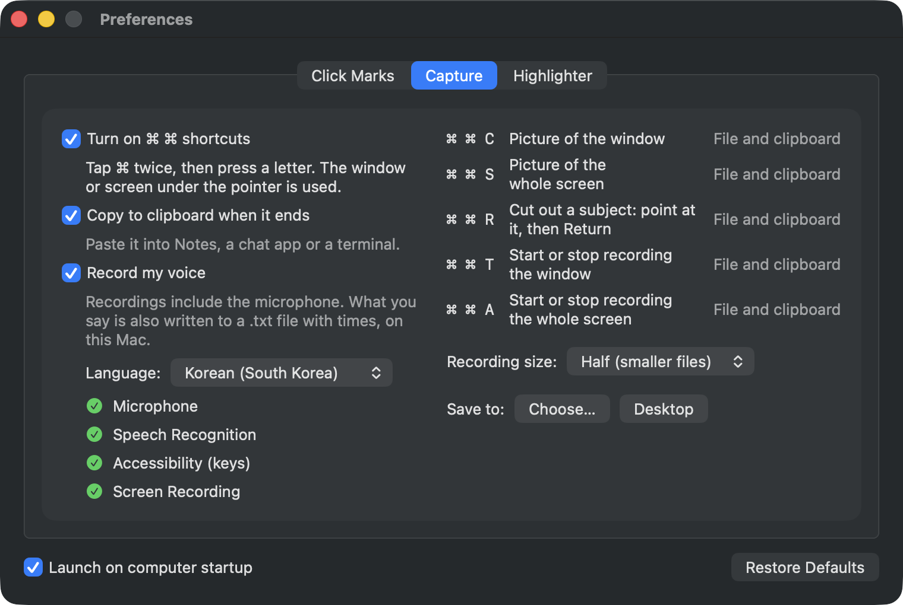

# Capture and Record Guide


Pointbit can take a picture or a recording of the window or the whole screen under the pointer.
Each one is a key sequence: tap ⌘ twice, then press one letter.

## Start with three

- ⌘ ⌘ T: record this window. ⌘ ⌘ T again stops.
- ⌘ ⌘ A: record all of the screen.
- While recording, hold ⌥ and drag (two fingers on a trackpad) to highlight.

The letters come in four groups, named by their first letters:

| Group | Keys | Words |
|---|---|---|
| Record | T · A · D | **T**his window · **A**ll screen · **D**raw a box |
| Picture | C · S · R | **C**apture window · **S**creen · **R**emove background |
| Pen shape | L · O · B | **L**ine · **O**val · **B**ox |
| Erase · color | Z · X · 1 2 3 | undo (as ⌘ Z) · erase all (as ⌘ X) · colors 1 2 3 |
| Zoom | M | **M**agnify: while recording, the video shows the part around the pointer at twice the size; M again goes back |

## Shortcuts

Place the pointer over the window or screen. Tap ⌘ twice quickly (each tap shorter than 0.3 s, the second
within 0.35 s of the first), then press the letter within 1 s.

| Keys | Action | Result |
|---|---|---|
| ⌘ ⌘ T | Start or stop recording the window under the pointer. The rect follows the window's top-left corner once it stands still, at its first size; at a screen edge it stops, and the highlighter lines stop with it (they then point at what the rect shows, not at the window) | `.mov` in the save folder |
| ⌘ ⌘ A | Start or stop recording the whole screen under the pointer | `.mov` in the save folder |
| ⌘ ⌘ D | Size a box first (drag a corner, an edge or the inside; Return starts, Esc cancels), then record it; ⌘ ⌘ D stops | `.mov` in the save folder |
| ⌘ ⌘ C | Picture of the window under the pointer (no shadow) | `.png` in the save folder; with Copy to clipboard on, the file and its path in the clipboard |
| ⌘ ⌘ S | Picture of the whole screen under the pointer | `.png` in the save folder; with Copy to clipboard on, the file and its path in the clipboard |
| ⌘ ⌘ R | Cut out a subject or a line of text (macOS 14 or later): the window under the pointer is taken once, then a box follows the line or subject under the pointer (all subjects on the background). Return or ⌘ ⌘ R saves, Esc cancels. Pause a video first: the choice is made on that first picture | transparent `.png`, cropped; for text the background colour is taken out (best on a plain background; very light text, near the background colour, can fade out too) and the words go in a `.txt` of the same name (read by Vision: check codes and numbers); a beep when nothing is found |
| ⌘ ⌘ Z | While recording: erase the last highlight (again for the one before) | — |
| ⌘ ⌘ X | While recording: erase all highlights | — |
| ⌘ ⌘ 1 · 2 · 3 | While recording: highlight color 1 · 2 · 3 | — |
| ⌘ ⌘ L · O · B | While recording: draw a free line (default), an oval or a box, until changed | — |
| ⌘ ⌘ M | While recording: zoom the video around the pointer (twice the size, it follows the pointer); again to go back. The screen does not zoom: the part the video shows is outlined and the rest is dimmed. Moving a ⌘ ⌘ T window ends the zoom | — |

- The four letters spell **tacs**: T and A record, C and S take a picture.
- The letter is not passed to the front app.
- Shortcuts that hold ⌘ while pressing a letter (⌘T, ⌘A, ⌘C, ⌘S, ⌘R, ⌘Z, ⌘X, ⌘1, ⌘2, ⌘3) are not affected.
- "Whole screen" is the display that the pointer is on.

## Setup

The shortcuts are off by default. Turn them on once:

| Step | What to do | Why |
|---|---|---|
| 1 | Menu bar icon → **Settings…** | It opens Preferences. |
| 2 | In the **Capture** tab, check **Turn on ⌘ ⌘ shortcuts**. | It turns the shortcuts on. |
| 3 | Allow Pointbit in System Settings → Privacy & Security → **Accessibility**. | It lets the app read the ⌘ ⌘ keys. |
| 4 | Allow Pointbit in **Screen & System Audio Recording** (the page opens after step 3). | It is needed for pictures and recordings. System and app sound is never recorded. |
| 5 | If the Screen Recording line still shows ✗, click **Reopen App**. | macOS applies this permission after the app reopens. |

The permission lines show ✓ when the setup is complete (Microphone and Speech Recognition only with Record my voice):



With the checkbox off, the app does not watch the keyboard.

## Results

| Type | File | Confirmation |
|---|---|---|
| Picture (C, S) | `TACS-<date>-<time>.png` (for example `TACS-20261101-095000123.png`, time with milliseconds) in the save folder, also copied to the clipboard when Copy to clipboard is on | White flash and shutter sound |
| Recording (T, A) | `TACS-<date>-<time>.mov` in the save folder (half size by default, or Full in Preferences → Capture → **Recording size**; H.264, or HEVC above 4K; 30 fps; sound only with Record my voice) | The seconds recorded (0, 1, 2 …) in the menu bar while recording |

The app sets no fixed time limit for a recording (free disk space still applies). At half size a minute is about 12 MB for a quiet window and 45–50 MB for a moving window or the whole screen (measured on an M1), so about 0.7–3 GB an hour; Full size may be larger (not measured). For an agent, a few minutes is easiest to look through; say the second shown in the menu bar to point at a moment.

Files go to the Desktop by default. To use another folder, choose it in Preferences → Capture → **Save to: Choose…**; **Desktop** switches back. If the chosen folder is moved or deleted, files go to the Desktop. A copied path that has a space or any character other than English letters, digits and / . _ - is put in single quotes, so it pastes into a shell as one argument.

With **Copy to clipboard when it ends** on (the default), the clipboard holds the file and its path when a picture or recording ends. Each app picks what it pastes: Notes, Mail or the Claude app paste the file, a terminal usually pastes the path. With it off, nothing is copied.

When two files are made in the same second, the second one gets "-2" at the end of its name (then "-3", and so on). Names have no spaces, so a pasted path works in a shell as is.

The menu bar shows a black target normally. While recording, the target is replaced by the seconds recorded (0, 1, 2 …, no minutes).

Recordings include the pointer and the click marks (left click red, right click green):


### Highlighter

While recording, hold ⌥ (Option) and draw. The line is in the video. While ⌥ is held, a small lavender dot at the pointer shows where the line starts; the dot is not in the video.

| Do | Result |
|---|---|
| Trackpad: hold ⌥ and move two fingers | Draws from the pointer; the pointer follows the line. Lift the fingers or release ⌥ to end it. One finger does not draw. |
| Mouse: hold ⌥ and drag with the left button | Draws. The app under the pointer does not get this press. |
| Add ⇧ (⌥ + ⇧) | A straight line from where the line started to the pen. Within 20° of level it is exactly horizontal or vertical; other angles stay as drawn. Pressing ⇧ mid-line straightens it; releasing ⇧ draws freely again. |
| A closed loop | Becomes a clean ellipse (a circle when nearly round). ⌘ ⌘ Z brings back the hand-drawn line first. |
| ⌥ + click on a line | Erases that line. Where lines cross, the line whose start is nearest the click. |
| ⌘ ⌘ Z | Erases the last line; again for the one before. |
| ⌘ ⌘ X | Erases all lines. |
| ⌘ ⌘ 1 · 2 · 3 | Color 1 · 2 · 3 for the next lines. Default yellow, red, blue; change them in Preferences → Highlighter → **Colors**. |
| ⌘ ⌘ O · ⌘ ⌘ B | The ⌥ drag draws an oval or a box from where it started (one corner) to the pen (the opposite corner), redrawn as it moves. With ⇧, a circle or a square. On a trackpad, lifting the fingers waits 0.6 s: touch again to make it bigger, or release ⌥ to finish at once. |
| ⌘ ⌘ L | Back to the free line (also when a new recording starts). |

Lines stay until erased. All lines are removed when the recording stops.

### Record my voice

Off by default. Turn it on in Preferences → Capture → **Record my voice**, and allow **Microphone** and
**Speech Recognition** when macOS asks.

- Recordings include the microphone. System and app sound is never recorded.
- After the recording ends, `TACS-<date>-<time>.txt` is written next to the `.mov`: what was said, one line per
  sentence or pause, each with its time in the video, for example `[01:05] This button does not respond.`
  An agent cannot hear a video, but it can read this file.
- Speech recognition runs on this Mac. On macOS 26 or later it uses SpeechAnalyzer (macOS downloads the language model once). On earlier macOS it needs **Dictation** on (System Settings → Keyboard → Dictation) and works in parts of 50 s; a word cut at a part's edge can be lost. A part that fails shows as a line such as `[00:50] (not recognized: 00:50–01:40)`. Choose the language under **Language** (default: the Mac's language).
- With **Copy to clipboard when it ends** on, the clipboard gets both files and both paths (video, a space, text) once the text
  file is written, unless something else was copied in between.
- Without the Microphone permission, or without a microphone, the video is still recorded, without sound.
- To write the `.txt` again for a recording (for example after turning Dictation on):
  `open -n /Applications/Pointbit.app --args --transcribe /path/TACS-<date>-<time>.mov`

### Stopping a recording

| Way | Note |
|---|---|
| ⌘ ⌘ T, ⌘ ⌘ A or ⌘ ⌘ D again | Any of them stops a recording, whichever started it. |
| Menu bar icon → **Stop Recording** | Shown only while recording. |
| Quit the app | The file is finished before the app quits. |

A window recording keeps the area where the window was when the recording started.
Turning the shortcuts off, or losing the Accessibility permission, also stops a recording.

## Troubleshooting

| Symptom | Fix |
|---|---|
| Nothing happens after ⌘ ⌘ and the letter | Check the permission lines in Preferences. Use **Open Settings** for a line with ✗. Check that the checkbox is on. |
| A beep and no file | Screen Recording is not allowed, or there is no window under the pointer. Allow Screen Recording and click **Reopen App**. |
| No menu bar icon, or no seconds while recording | On a Mac with a notch, macOS hides menu bar icons that do not fit beside it. A recording adds the macOS recording indicator, which can push the icon out. Hold ⌘ and drag the icon to the right, or turn off other icons in System Settings → **Menu Bar**. |
| "macOS stopped the key capture" in Preferences | Turn the checkbox off and on. |
| The keyboard does not respond | Choose Apple menu → **Force Quit…**, then select Pointbit. This is not expected: the tap that can hold back keys exists for at most 3 s. |
| "Apple could not verify…" on first open | Open System Settings → Privacy & Security, click **Open Anyway**, then **Open** in the warning. This is needed once ([Apple's steps](https://support.apple.com/en-us/102445)). |

### Resetting the permissions

Quit the app from the menu bar first, then run:

```
tccutil reset Accessibility si.codegg.pointbit
tccutil reset ScreenCapture si.codegg.pointbit
open /Applications/Pointbit.app --args --settings
```

## How it works

| Part | Detail |
|---|---|
| Key watching | A listen-only event tap reads the keys. It cannot hold back or delay input. |
| Holding back the letter | A second tap exists only from the second ⌘ press until the letter is released, for at most 3 s. |
| Pictures | `/usr/sbin/screencapture` with the window id (C) or the screen rectangle (S). |
| Recordings | ScreenCaptureKit captures the display and crops it to the window or screen; AVAssetWriter writes the `.mov`. |
| Highlighter | An event tap exists only while recording. It reads ⌥ and passes it on; it holds back only an ⌥ + press with its drag and release, and two-finger scrolls while ⌥ is held. If macOS turns it off, it is removed, not turned on again. |
| Voice and text | AVCaptureSession reads the microphone into the `.mov`. Speech recognition (`requiresOnDeviceRecognition`) reads the sound track after the recording and writes the `.txt`. |
